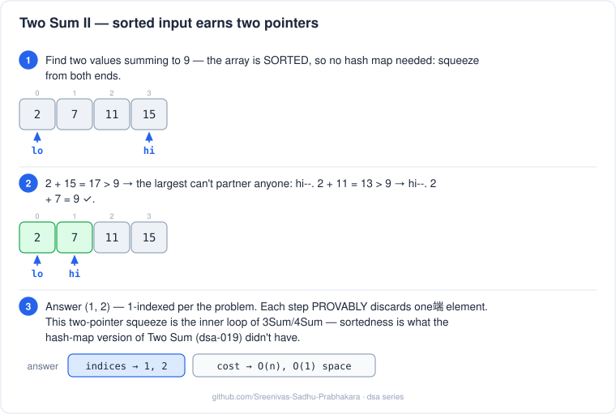

# Two Sum II (Sorted Input)

> NeetCode 150 · Two Pointers — sorted input turns the hash map into two converging pointers: sum too small moves left up, too big moves right down. Go, stdlib only, tested.

## Problem

Two Sum again, but the array is sorted and the answer wants 1-based indices with O(1) extra space — which outlaws the hash map that solved dsa-019.

## Approach

Pointers at both ends. The current sum being too small means nothing pairs usefully with `numbers[l]` anymore (even the largest partner fell short) — discard it, move up; symmetric logic moves the right pointer down on overshoot. Every step eliminates one element for good, so the walk is linear and allocation-free. This pair-search is the engine inside 3Sum and 4Sum (dsa-039/020); NeetCode keeps it as its own entry precisely because it's the reusable part. The 1-based indices are a specification quirk worth reading twice in a real interview.

**Complexity:** O(n) time, O(1) space.

## Visual walkthrough

Read the picture top to bottom — each numbered frame is one moment of the algorithm
running on this repo's test example.

## Run

    go test ./...   # verify
    go run .        # demo

---

Part of a 275-repo DSA series in Go — Striver's SDE Sheet (dsa-001–191) plus the NeetCode 150 / Blind 75 additions (dsa-192–275), stdlib only, every solution tested. Browse: [`dsa-*` repos](https://github.com/Sreenivas-Sadhu-Prabhakara?tab=repositories&q=dsa-&type=source).
